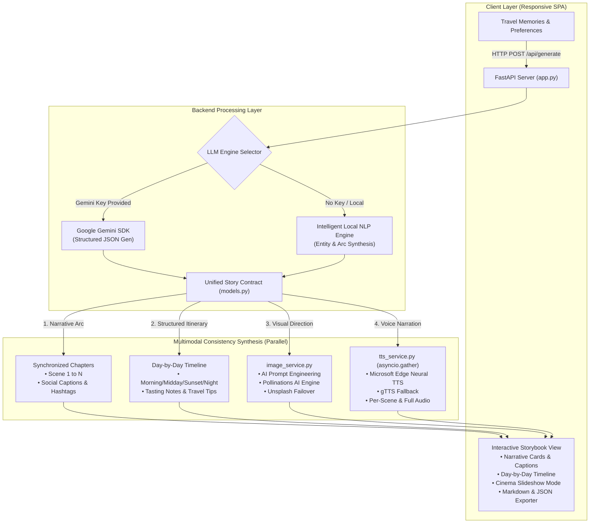

# 🧭 Wayfarer AI — Intelligent Travel Story Generator

A multimodal AI web application that converts unstructured travel notes, journal entries, or memories into a synchronized digital travel story containing **narrative chapters, day-by-day itineraries, visual scenes, captions, and neural voiceover narration**.

---

## 🏗️ System Architecture



---

## 🌟 Key Features

1. **Multimodal Cohesion**: Text, visuals, and audio are cross-aligned. Each visual scene directly illustrates the chapter narrative, corresponds to that day's itinerary stop, and plays synchronized neural audio narration.
2. **Dual-Engine Flexibility**:
   - **Built-in Intelligent NLP Engine**: Works 100% out-of-the-box offline/without any API key.
   - **Google Gemini 2.5 Flash SDK**: Seamlessly unlocks advanced generative depth if an API key is supplied.
3. **Neural Voice Narration (`edge-tts` & `gTTS`)**:
   - Full master story narration + per-scene individual audio tracks.
   - 5 expressive voices (Jenny, Guy, Sonia, Ryan, Natasha).
4. **AI Visual Scene Generation**:
   - High-fidelity photographic prompts synthesized for Pollinations AI with Unsplash fallback.
   - Interactive visual prompt inspector & high-res image lightbox.
5. **Day-by-Day Itinerary**:
   - Structured time slots (Morning, Midday, Golden Hour, Evening).
   - Authentic local tasting recommendations and insider pro-tips.
6. **Cinema Presentation Mode**:
   - Fullscreen theatrical slideshow with Ken Burns zoom animation and auto-advancing audio narration.
7. **One-Click Export**:
   - Export story as Markdown (`.md`), raw JSON data (`.json`), or print as a clean editorial PDF booklet.

---

## 🚀 Quickstart

### 1. Install Dependencies
```bash
pip install -r requirements.txt
```

### 2. Launch the Application
Run the launcher script:
```bash
run.bat
```
Or with python:
```bash
python app.py
```

### 3. Open in Browser
Navigate to:
```
http://localhost:8001
```

---

## 📁 Project Structure

```
travel-story-generator/
├── app.py                 # FastAPI backend server with REST endpoints & static routes
├── requirements.txt       # Python package dependencies
├── run.bat                # Windows quick launcher batch file
├── README.md              # Project documentation & architectural guide
├── services/
│   ├── __init__.py
│   ├── models.py          # Pydantic data schemas (Story, Scene, Itinerary, Audio)
│   ├── story_engine.py    # Dual-backend story generator (Gemini + Local NLP + Presets)
│   ├── tts_service.py     # Concurrent neural TTS engine (Edge TTS + gTTS)
│   └── image_service.py   # AI prompt enhancement & visual scene provider
└── static/
    ├── index.html         # Responsive web application UI (Tailwind + Lucide)
    ├── styles.css         # Glassmorphism, animations, audio waves, print styles
    ├── app.js            # Frontend state, audio sync, cinema mode, exports
    └── audio/             # Generated MP3 audio cache
```

